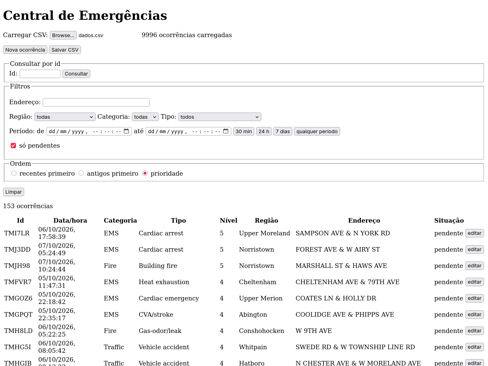

# fickel0/emergencies

> [!NOTE] 
> This is coursework for Computer Engineering at UFPel. It's educational. You might find a lot of Brazilian Portuguese.

Web CRUD for 911 emergency calls with compound queries. A [dataset from Kaggle](https://www.kaggle.com/datasets/mchirico/montcoalert) is preprocessed in Python then inserted into a sort of proto-database (though it's all in RAM). The point is the data structures: B+ tree for record storage, hash table for indexing and trie for autocomplete. Beats linear search.

**Test it by opening `index.html` in your browser then loading `dados.csv`.**

[Documentação em português aqui!](DOCUMENTACAO.md)
